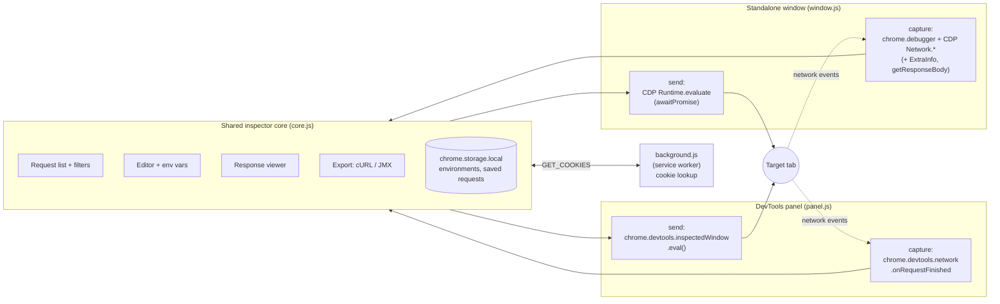

<div align="center">


# API Request Inspector & Resender

**Capture, inspect, edit, replay, compare and export the HTTP traffic of any web app, straight from Chrome.**


[Features](#-features) •
[Installation](#-installation) •
[Usage](#-usage) •
[Export to JMeter](#-export-to-curl--jmeter) •
[Architecture](#-architecture) •
[Troubleshooting](#-troubleshooting)

</div>

---

## 📖 Overview

**API Request Inspector & Resender** is a Chrome extension for developers, QA engineers and performance testers. It records the API calls a web page makes, shows full request and response details, and lets you **edit a request and send it again from inside the page**, so it runs with the page's own session and cookies.

Captured traffic can be **diffed** to catch regressions, **saved** into named collections, parameterised with **environment variables** (`{{baseUrl}}`), and **exported to cURL or a ready-to-run JMeter `.jmx` test plan**. That turns a real user flow into a load test without typing any request by hand.

You can run it in two ways:

| Mode | How to open | What it watches | Best for |
|------|-------------|-----------------|----------|
| **DevTools panel** | `F12` → **API Inspector** tab | The tab DevTools is open on | Quick inspection while you are already in DevTools |
| **Standalone window** | Toolbar icon → **🪟 Open Inspector Window** | **Any open tab you pick** | Watching one tab while you work in another, or replaying requests into a specific tab |

---

## ✨ Features

### 🔍 Live capture
- Captures **Fetch/XHR** and every other resource type: documents, scripts, stylesheets, fonts, images, media, manifests, WebSockets and Wasm.
- **The full headers as sent on the wire.** In the standalone window, headers the browser adds itself (`cookie`, `content-length`, `sec-fetch-*` and others) are merged in from Chrome's `*ExtraInfo` network events.
- Request and response bodies, status code, status text, duration and timestamp.
- **Redirect chains** are split into one entry per hop (`[Redirect 302 → /next]`), so no hop is lost.
- Binary responses are labelled rather than dumped as raw bytes.

### 🎛️ Filtering (like Chrome's Network tab)
- **Resource-type chips:** `All · Fetch/XHR · Doc · CSS · JS · Font · Img · Media · Manifest · Socket · Wasm · Other`. You can select several at once.
- **More filters:** free-text search on URL or method, an HTTP-method filter, and **Hide `data:` URLs**.
- **📌 Pin** requests so that **Clear** keeps them.

### ✏️ Request editor and resend
- Edit the **method, URL, headers (as JSON) and body**, then **▶️ Send Request**.
- The request runs **in the target page's own context**, so it carries the real logged-in session.
- **Include cookies** toggle: `credentials: "include"` or `"same-origin"`.
- Bodies are encoded automatically from `Content-Type` (JSON, `x-www-form-urlencoded` or raw).
- **↺ Reset** restores the request as it was captured.

### 📄 Response viewer
- Tabs for **Body** (JSON with syntax highlighting), **Headers** and **Cookies**.
- Colour-coded status: 2xx, 3xx, 4xx, 5xx and pending.
- Errors are shown in their own panel.

### 🌐 Environments and variables
- Define environments such as *Development*, *Staging* and *Production*, each with its own variables.
- Use `{{variable}}` placeholders in the **URL, headers and body**. They are substituted when the request is sent.
- Switch environment from the header dropdown.

### 💾 Saved requests
- Save any request with a **name**, an optional **collection** and a **description**.
- Saved requests are grouped by collection, can be loaded back into the editor, and persist across browser restarts in `chrome.storage.local`.

### ⚖️ Compare responses
- Line-by-line **side-by-side diff** of two captured responses, with added, removed and changed lines highlighted.

### ⬇️ Export
- **Copy as cURL** for one request, or **Copy all as cURL** with one command per line, ready for JMeter's *Import from cURL*.
- **Export to `.jmx`** for the selected request or for every request that passes the current filters. The file opens directly in Apache JMeter.

### 🎨 Interface
- A three-pane layout: request list, editor and response.
- **Light and dark themes.** Your choice is remembered.
- Built-in **❓ Help** dialog.

---

## 📦 Installation

The extension has **no dependencies and no build step**. It is plain HTML, CSS and JavaScript.

### Load it unpacked (developer mode)

1. **Get the code**
   ```bash
   git clone https://github.com/Arif-Uz-Zaman/API-Inspect.git
   ```
   You can also download the ZIP from GitHub and extract it.

2. Open **`chrome://extensions`** in Chrome.

3. Turn on **Developer mode** (the toggle in the top-right corner).

4. Click **Load unpacked** and select the folder that contains `manifest.json`.

5. Optionally, pin **API Request Inspector & Resender** to the toolbar from the puzzle-piece menu.

> **Updating:** after pulling new code, click the **⟳ reload** icon on the extension's card in `chrome://extensions`, then close and reopen DevTools or the Inspector window.

### Requirements
- **Google Chrome** with Manifest V3 support (any current version).
- Other Chromium-based browsers that support MV3 and the `chrome.debugger` API (Edge, Brave and others) should also work, but Chrome is the main target.
- To use the JMeter export: **Apache JMeter 5.x**. The plan is generated with the 5.6.3 format.

---

## 🚀 Usage

### Option A: DevTools panel

1. Open the site you want to inspect.
2. Press **`F12`**, or right-click → **Inspect**.
3. Open the **API Inspector** tab. It may be hidden under the `»` overflow menu.
4. Use the site. Requests appear in the left pane as they finish.

> Like Chrome's Network tab, the panel only records traffic **while DevTools is open**. Open it first, then reload the page if you need the page-load requests.

### Option B: standalone Inspector window

1. Click the extension's toolbar icon, then **🪟 Open Inspector Window**.
2. In the **Listening to:** bar, choose a tab from the dropdown. Click **↻** to refresh the list.
3. The status changes to **● Listening**. Chrome shows a yellow *"…started debugging this browser"* banner, which is expected.
4. Click **⟳ Reload tab** to capture the full page load, or just use the app in that tab.
5. When you are finished, click **Detach** or close the window.

### Inspecting and resending a request

1. Click a request in the left pane.
2. The **Request Editor** fills in with the method, URL, headers and body. The **Response** pane shows what the server returned.
3. Change anything you like, for example a header value, a body field or the method.
4. Click **▶️ Send Request**. The new response replaces the old one in the right pane.
5. Click **↺ Reset** to go back to the request as it was captured.

### Using environment variables

1. Click **⚙️** (Manage Environments) in the header.
2. Enter a name, for example `Staging`, then click **+ Add Variable**, for example `baseUrl` = `https://staging.api.example.com`.
3. Click **Save Environment**, then select it in the environment dropdown.
4. Write requests with placeholders:
   ```text
   URL:     {{baseUrl}}/v1/users/{{userId}}
   Headers: { "Authorization": "Bearer {{token}}" }
   ```
5. Choose a different environment to send the same request to Dev, Staging or Prod.

### Saving and reusing requests

- Select a request, click **💾 Save**, and give it a name, an optional collection and an optional description.
- Open your library with **💾** in the header. From there you can **load** a request into the editor or **delete** it.

### Comparing two responses

1. Capture at least two requests, for example the same endpoint before and after a deploy.
2. Select a request and click **⚖️ Compare**.
3. Pick the two requests and click **Compare** to see the side-by-side diff.

---

## ⬇ Export to cURL & JMeter

Open the **⬇ Export** menu in the header:

| Option | What it does |
|--------|--------------|
| 📋 **Copy selected as cURL** | Copies a multi-line cURL command for the request in the editor, **including your edits**. |
| 📋 **Copy all as cURL (JMeter)** | Copies one single-line cURL command per request that passes the current filters. |
| 📦 **Export selected → .jmx** | Downloads `api-inspector-request.jmx` containing the request in the editor. |
| 📦 **Export all → .jmx** | Downloads `api-inspector-requests.jmx` containing every request that passes the current filters. |

### What goes into the `.jmx` file

```
Test Plan: "API Inspector Export"
└── Thread Group (1 thread, 1 loop, continue on error)
    ├── HTTP Request: "POST /api/login"
    │   └── HTTP Header Manager (that request's headers)
    ├── HTTP Request: "GET /api/users?page=1"
    │   └── HTTP Header Manager
    └── …
```

- Each sampler records the protocol, host, port, path and query, and method. **Follow redirects** and **keep-alive** are turned on.
- **Form bodies** (`application/x-www-form-urlencoded`) are split into **separate JMeter parameters** with one name and value per row.
- **JSON and other bodies** are sent as a **raw body**. If no `Content-Type` was present, `application/json` is added.
- **Headers that cURL and JMeter must compute themselves are removed:** `content-length`, `host` and HTTP/2 pseudo-headers (`:authority`, `:path`, …). A stale copy of any of these would corrupt the replayed request.

### Recipe: turn a user flow into a load test

1. Open the Inspector window, select the target tab and click **⟳ Reload tab**.
2. Go through the flow in the app, for example log in, search and check out.
3. Select the **Fetch/XHR** chip so that only API calls remain.
4. Click **⬇ Export → Export all → .jmx**.
5. In JMeter, open the file (**File → Open**), then raise the thread count, ramp-up and loops in the Thread Group.

If you prefer pasting, use **Copy all as cURL** instead, then **JMeter → Tools → Import from cURL**.

---

## 🏗 Architecture

Both modes use the **same UI and logic** (`core.js`). They differ only in a small **transport adapter**, which decides how requests are captured and how a replayed request is run in the page.



### The transport contract

`core.js` exposes `window.initInspector(transport)`. Each adapter passes in an object of this shape:

```js
const transport = {
  tabId,              // id of the target tab (may be null until one is chosen)
  start(onRequest),   // begin capturing; call onRequest(requestData) for each request or update
  evalCode(code),     // Promise<result>: run JS in the target page's context
  clear()             // optional: reset backend capture state
};
```

**Resending:** the core builds a self-contained `async` `fetch(...)` expression from the editor fields, after substituting environment variables and removing pseudo-headers. It then runs that expression with `transport.evalCode()`. Because the call happens **inside the page**, it uses the page's origin, cookies and session.

### Captured request shape

```js
{
  id, type,               // "devtools" | "debugger"
  resourceType,           // "XHR" | "Fetch" | "Document" | "Script" | ...
  url, method,
  headers,                // request headers (object)
  requestBody,            // parsed JSON when possible, otherwise a string
  timestamp,
  status, statusText,
  responseHeaders,
  responseBody,           // parsed JSON when possible, otherwise a string or a label
  duration,               // ms
  error,
  pinned                  // set by the UI
}
```

---

## 📁 Project structure

```
extension/
├── manifest.json          # MV3 manifest: permissions, service worker, devtools page, popup
├── background.js          # Service worker: cookie lookup (GET_COOKIES), per-tab request store, message relay
│
├── devtools.html/.js      # Registers the "API Inspector" DevTools panel
├── panel.html             # DevTools panel UI
├── panel.js               # DevTools transport (devtools.network + inspectedWindow.eval)
│
├── popup.html/.js         # Toolbar popup; opens the standalone Inspector window
├── window.html            # Standalone window UI (panel UI + "Listening to:" target bar)
├── window.js              # Debugger transport (chrome.debugger / Chrome DevTools Protocol)
│
├── core.js                # Shared core: list, filters, editor, resend, env vars, saved
│                          # requests, compare, cURL/JMX export, theme
├── styles.css             # Shared styles (light + dark themes)
│
├── contentScript.js       # ISOLATED-world message bridge (see note below)
├── pageInterceptor.js     # MAIN-world fetch/XHR wrapper (see note below)
│
├── icons/                 # icon16/48/128.png, icon.svg, icon generator pages
│
├── QA_GUIDE.md            # One-page QA guide (English)
├── QA_GUIDE_BN.md         # QA guide (Bangla + English)
└── RELEASE_NOTES.md       # v1.0.0 release notes and use cases
```

> **Note:** `contentScript.js` and `pageInterceptor.js` implement a fetch/XHR interception path that runs in the page. They are **not registered** under `content_scripts` in the current `manifest.json`, so they do not run. All capture goes through the DevTools Network API or the debugger. To turn them back on, add a `content_scripts` entry, with `"world": "MAIN"` for `pageInterceptor.js`.

---

## 🔐 Permissions

| Permission | Why it is needed |
|------------|------------------|
| `debugger` | Lets the standalone window attach to a tab you choose, read its network events (including full headers and bodies) and run replayed requests in it. |
| `tabs` | Lists open tabs in the **Listening to:** picker and reloads the target tab. |
| `cookies` | Fills the **Cookies** tab of the response viewer for the request's URL. |
| `storage` | Keeps environments and saved requests in `chrome.storage.local`. |
| `webRequest` | Declared in the manifest. The current code does not use it. |
| `<all_urls>` (host) | Allows capture, cookie lookup and replay on any site you choose to inspect. |

**Privacy:** everything stays **in your browser**. The extension has no backend, no analytics and no telemetry. Captured requests are held in memory and are lost when the panel or window closes, unless you pin, save or export them. Saved requests and environments, which may contain tokens, are stored unencrypted in `chrome.storage.local` on your machine.

---

## 🛠 Troubleshooting

| Symptom | Cause and fix |
|---------|---------------|
| **The window shows 0 requests** | Capture only starts **after** the window attaches. Click **⟳ Reload tab**, or trigger new requests in the target tab. |
| **"Another debugger is already attached"** or attaching fails | A tab can have only one debugger at a time. **Close DevTools on the target tab**, or detach the other tool, then try again. |
| **A yellow "…started debugging this browser" banner** | Expected while the window is attached. It disappears when you click **Detach** or close the window. |
| **The panel is missing earlier requests** | The DevTools panel only sees traffic while DevTools is open. Open DevTools, then reload the page. |
| **`Invalid JSON in headers field`** | The headers editor must contain a valid JSON object, for example `{ "Accept": "application/json" }`. |
| **A resent request fails with a CORS error** | The replay runs in the page with the page's origin, so normal browser CORS rules apply to cross-origin URLs. Send it from a tab on the API's own origin, or use the exported cURL command. |
| **HTTP/2 pseudo-headers (`:authority`, `:path`) are missing or removed** | The browser does not let `fetch` set them, so they are removed before resend and export. They do not affect the request. |
| **A response body shows `[Binary response]`** | The response was not text, for example an image, a PDF or a protobuf. Only text and JSON bodies are displayed. |
| **The Cookies tab is empty** | No cookies are stored for that URL, or the request has not been selected yet. |

---

## 👥 Who it's for

- **QA and test engineers.** Reproduce bugs with the exact failing request. Diff responses before and after a deploy. Build JMeter load tests from real flows.
- **Developers.** Debug what the front end actually sends. Iterate on an endpoint without Postman or code changes. Share a reproduction as cURL.
- **Performance engineers and SREs.** Start a performance test from realistic traffic. Check how many JS, image and font requests a page makes.
- **Support staff and analysts.** Record the calls behind a feature, such as a report download, and document example requests in collections.

For more walkthroughs, see **[QA_GUIDE.md](QA_GUIDE.md)**, **[QA_GUIDE_BN.md](QA_GUIDE_BN.md)** (বাংলা) and **[RELEASE_NOTES.md](RELEASE_NOTES.md)**.

---

## 🤝 Contributing

Contributions are welcome.

1. Fork the repository and create a branch: `git checkout -b feature/my-feature`.
2. Make your changes. There is no build step: reload the extension in `chrome://extensions` to test.
3. Test **both** modes, the DevTools panel and the standalone window, because they share `core.js`.
4. Commit with a clear message and open a pull request.

**Code layout tips**
- UI behaviour that both modes share goes in **`core.js`**.
- Logic for capturing requests or running code in the page goes in the adapter: **`panel.js`** or **`window.js`**.
- Keep `panel.html` and `window.html` in sync when you add UI elements. They share the same element IDs.

---

## ⚠️ Responsible use

Captured and replayed requests run with the **real, logged-in session** of the target tab. Use this tool only on applications and accounts that **you own or are authorised to test**. Be careful when sharing exported cURL or `.jmx` files, because they can contain **cookies, bearer tokens and other credentials**.

---

## 📄 License

No license has been chosen for this project yet. Until a `LICENSE` file is added, all rights are reserved by the author.

---

<div align="center">

Made for developers and QA engineers who are tired of retyping requests.

⭐ If this extension saves you time, consider giving the repo a star.

</div>
